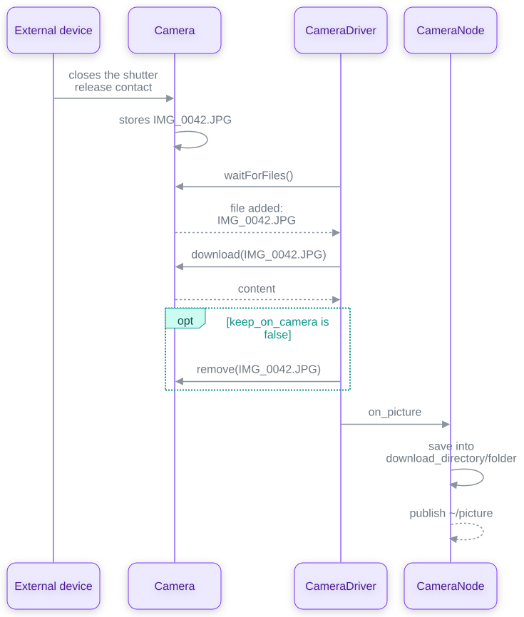
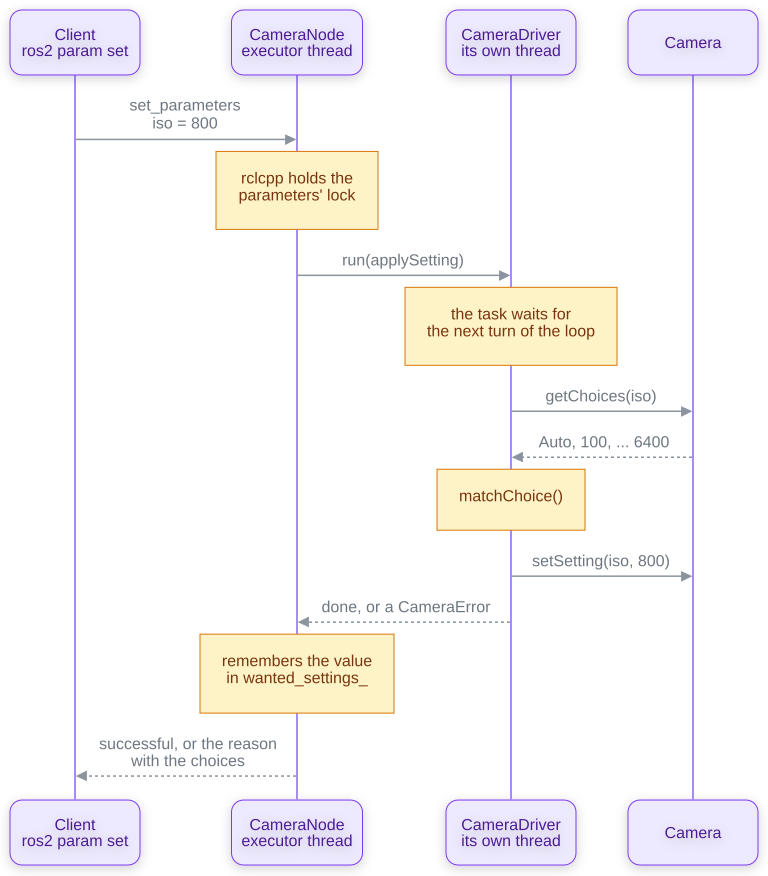

# StepIt Camera Architecture

## Table of Contents <!-- omit in toc -->

- [Introduction](#introduction)
- [The Big Picture](#the-big-picture)
- [The Packages](#the-packages)
- [The Classes](#the-classes)
  - [Camera](#camera)
  - [GPhotoCamera](#gphotocamera)
  - [FakeCamera](#fakecamera)
  - [CameraDriver](#cameradriver)
  - [CameraNode](#cameranode)
- [One Thread Owns the Camera](#one-thread-owns-the-camera)
- [Streaming](#streaming)
- [Downloading the Pictures](#downloading-the-pictures)
- [The Web Server](#the-web-server)
- [The Exposure](#the-exposure)
- [Losing the Camera](#losing-the-camera)
- [The Container](#the-container)
- [Tests](#tests)
- [How to Extend the Driver](#how-to-extend-the-driver)
- [Design Decisions and Trade-offs](#design-decisions-and-trade-offs)

## Introduction

This document explains how StepIt Camera is built, what each part is responsible for, and where to start when we want to change something. It assumes we have read the [README](../README.md) and run the driver once.

It follows one idea: **the camera is a device that answers one request at a time**. Everything the driver does, streaming, downloading and changing a setting, goes through a single thread that owns the camera, and the rest of the node only talks to that thread.

## The Big Picture

The camera is fired by an external device, plugged into its remote shutter release socket, or by its own shutter button. The driver does not decide when to take a picture: it watches the camera over USB, downloads the pictures it takes, streams its live view and changes its settings. The one exception is a test shot, `~/take_picture`, which releases the shutter over USB to check the framing and the exposure.

<!-- The source is diagrams/big-picture.mmd: change it, then run bin/render-diagrams.sh. -->
<p align="center"></p>

The node's interface:

| Name | Type | What it does |
|---|---|---|
| `~/preview/compressed` | `sensor_msgs/CompressedImage` topic | The live view, as JPEG frames, while streaming. |
| `~/picture` | `stepit_camera_msgs/Picture` topic | Each picture the camera takes, once saved: its `name` and its `folder` on the camera, where the file is, `path`, and its path under `download_directory`, `relative_path`. Reliable, with a depth of 10, not latched: a client that subscribes after a picture does not get it. |
| `~/start_streaming`, `~/stop_streaming` | `std_srvs/Trigger` services | Switch the live view on and off. `start_streaming` answers at once; `stop_streaming` answers once the camera has left the live view, or with `success` false when it has not within 5 seconds. |
| `~/get_settings` | `stepit_camera_msgs/GetSettings` service | The current exposure, and the values each setting accepts. `success` is false while no camera is connected. |
| `~/take_picture` | `std_srvs/Trigger` service | A test shot: release the shutter over USB. The picture comes on `~/picture`. `success` is false while no camera is connected. |
| `~/status` | `stepit_camera_msgs/CameraStatus` topic | Whether a camera is connected, its model, and why not, and whether the live view is asked for: reliable and transient local, published when it changes and every second. |
| `iso`, `shutter_speed`, `aperture`, `exposure_compensation`, `white_balance` | parameters | The settings of the camera, see [The Exposure](#the-exposure). |
| `folder` | parameter | The subfolder of `download_directory` the next pictures go into; it can change while the camera runs. |
| `fake_camera`, `frame_id`, `download_directory`, `keep_on_camera`, `stream_on_start`, `preview_rate`, `reconnect_period` | read-only parameters | Set when the node starts, in [`camera.yaml`](../src/stepit_camera/config/camera.yaml) or by a launch argument; the [README](../README.md#parameters) describes each one. |

The launch file, [`camera.launch.py`](../src/stepit_camera/launch/camera.launch.py), also starts three servers for web pages; a launch argument leaves each one out:

| Server | Port | Launch arguments | What it serves |
|---|---|---|---|
| `web_server`, of this package | `8090` | `web`, `web_port` | The test page, the saved pictures, the listings of their folders and the description of its API, over HTTP: see [The Web Server](#the-web-server). |
| [web_video_server](https://github.com/RobotWebTools/web_video_server) | `8081` | `web_video`, `web_video_port` | The live view as MJPEG, at `/stream?topic=/camera/preview&type=ros_compressed`: `ros_compressed` passes the camera's JPEG frames through. |
| [rosbridge](https://github.com/RobotWebTools/rosbridge_suite) | `9091` | `rosbridge`, `rosbridge_port` | The services, the parameters and the topics, as JSON over a WebSocket. |

The other launch arguments are `fake`, which runs the fake camera, `stream`, which starts the live view with the node, and `params_file`, a parameter file loaded after `camera.yaml` for both the camera node and the web server: a project that runs the camera sets its own values there, e.g. `download_directory`, without changing this package. The launch arguments are applied last. `camera.yaml` gives its parameters to `/**`, i.e. to a node of any name, which is how the web server reads the same `download_directory` as the camera node.

The camera brings a rosbridge of its own because a rosbridge can only handle the messages installed in its own environment, and this one is sure to know `stepit_camera_msgs`. It is not on rosbridge's default port, 9090, so that it can run next to another rosbridge on the same machine; where another rosbridge knows the camera's messages, `rosbridge:=false` leaves this one out.

## The Packages

The code, its interfaces and its tests live in separate packages, so that a node that only talks to the camera needs only `stepit_camera_msgs`, and the tests can depend on anything without the driver doing so.

| Package | Owns | Depends on | Must never |
|---|---|---|---|
| `stepit_camera_msgs` | The messages `Picture`, `CameraStatus` and `Setting`, and the service `GetSettings`. No code. | `std_msgs` | Carry the content of a picture, see [Design Decisions and Trade-offs](#design-decisions-and-trade-offs). |
| `stepit_camera` | The driver: a shared library holding every class, the executables `camera_node` and `web_server`, `camera.yaml` and the launch file. | `rclcpp`, `sensor_msgs`, `std_srvs`, `stepit_camera_msgs`; privately libgphoto2, libjpeg and cpp-httplib; when launched, rosbridge and web_video_server | Carry a test. |
| `stepit_camera_tests` | All tests, run against the fake camera. | `stepit_camera`, gtest, and cpp-httplib as the HTTP client of `test_web_server` | Need a camera. |

The library is shared rather than static, so that its private dependencies, libgphoto2, libjpeg and cpp-httplib, do not leak into the packages that link it, i.e. the tests.

The test page, in [`web`](../web), is not a ROS package: a `COLCON_IGNORE` keeps colcon out of it, and the scripts in `bin` build and test it with pnpm. See [WEB_PAGE.md](WEB_PAGE.md).

Inside the library, the includes go one way, from the node down to the interface of a camera:

<!-- The source is diagrams/packages.mmd: change it, then run bin/render-diagrams.sh. -->
<p align="center"></p>

- `Camera` and `CameraDriver` include the standard library only: no ROS, no libgphoto2.
- `gphoto_camera.cpp` is the only file that includes libgphoto2; its header only declares the two libgphoto2 types it points to.
- `CameraNode` is the only class that includes ROS and the messages. It is also where the camera is chosen, a `FakeCamera` or a `GPhotoCamera`: nothing below it knows which one runs.
- `WebServer` includes cpp-httplib and nothing of the camera or of ROS, although it is built into the same library; `web_server_main.cpp` gives it its folders from the ROS parameters, with `expandHome()` of `settings`.

No include breaks these rules.

## The Classes

<!-- The source is diagrams/classes.mmd: change it, then run bin/render-diagrams.sh. -->
<p align="center"></p>

### Camera

[`camera.hpp`](../src/stepit_camera/include/stepit_camera/camera.hpp) is the interface between the driver and a camera: the handful of operations the driver needs, and nothing of libgphoto2. Every failure is a `CameraError`, which tells whether it is **fatal**, i.e. the connection is gone, or not, e.g. a value the camera refuses. That one flag decides everything the driver does about errors, see [Losing the Camera](#losing-the-camera).

The settings are named as libgphoto2 names them, e.g. `shutterspeed`, which is what `gphoto2 --list-config` shows. Their values are text, exactly as the camera shows them, e.g. `1/125`.

### GPhotoCamera

[`gphoto_camera.cpp`](../src/stepit_camera/src/gphoto_camera.cpp) implements the interface with libgphoto2. It opens the first camera libgphoto2 detects: the driver drives one camera. It is the only file that includes the libgphoto2 headers.

A few details that matter on a Canon EOS:

- **The live view** starts with the first `gp_camera_capture_preview`, and only stops when the setting `viewfinder` is switched off. `stopPreview()` does that, so that the mirror goes down again.
- **A shot during the live view** stops it, although `viewfinder` still reads on: every frame fails until `viewfinder` is switched off and on again. The driver does that, see [Losing the Camera](#losing-the-camera).
- **A test shot** is `gp_camera_trigger_capture`, which presses and releases the shutter button remotely, and works during the live view. The shutter button on the body of a 5D Mark II, on the other hand, does nothing while the live view runs over USB.
- **The events.** The camera reports a stream of events, most of them about properties that changed. `waitForFiles()` keeps reading them until a file is added or the time is up, then collects whatever else is already queued, because RAW+JPEG adds two files for one shot.
- **The fatal errors** are the errors of the USB port (`GP_ERROR_IO` and `GP_ERROR_IO_*`) and the camera no longer being found; `open()` failing is always fatal, whatever the error. A camera busy writing a picture to the card (`GP_ERROR_CAMERA_BUSY`) is not fatal.
- **A camera without the setting `viewfinder`** is left as it is by `stopPreview()`, which returns without an error.

### FakeCamera

[`fake_camera.cpp`](../src/stepit_camera/src/fake_camera.cpp) is a camera that exists only in memory, with the settings and the choices of a 5D Mark II on M. Its live view is a moving test pattern, encoded with libjpeg, and `trigger()` stands for the external device firing the shutter. Like a 5D Mark II, a shot during the live view breaks it until `stopPreview()`. `setConnected(false)` unplugs it, to test the reconnection.

It runs in the tests, and in the node with the parameter `fake_camera`, where the service `~/take_picture` calls `trigger()`, as it does on a real camera, and gets one JPEG; `trigger(true)`, which adds a file named `.CR2` that is not a real RAW, is for the tests. Unlike a real camera, it is thread safe, so that a test can trigger it while the driver's thread waits for its pictures.

### CameraDriver

[`camera_driver.cpp`](../src/stepit_camera/src/camera_driver.cpp) runs the camera on a thread of its own, see [One Thread Owns the Camera](#one-thread-owns-the-camera). It knows nothing of ROS: it hands the frames and the pictures over through callbacks, and other threads reach the camera through `run()`.

### CameraNode

[`camera_node.cpp`](../src/stepit_camera/src/camera_node.cpp) is the ROS2 interface. It declares the parameters, creates the publishers and the services, and turns the callbacks of the driver into messages. It configures the camera every time the driver connects to it. Its second constructor takes the `Camera` to run, so that a test hands it a fake one and unplugs it.

[`settings.cpp`](../src/stepit_camera/src/settings.cpp) holds what the node and the web server need and can be tested alone: the table of the settings exposed as parameters, matching a value to the camera's choices, choosing the capture target, expanding `~`, checking the folder of the pictures, and saving a picture without overwriting another one.

## One Thread Owns the Camera

libgphoto2 is not thread safe, and a camera answers one request at a time over USB. The driver therefore gives the camera to a single thread, which runs this loop:

<!-- The source is diagrams/thread-loop.mmd: change it, then run bin/render-diagrams.sh. -->
<p align="center"></p>

Any other thread that needs the camera, e.g. the node changing the ISO, queues a **task** with `CameraDriver::run()`, and waits for its result. A task is a function of the camera wrapped in a `std::packaged_task`, so its return value and its exceptions reach the caller as if it had called the camera itself. The loop runs the queued tasks at every turn, and a turn lasts at most `poll_period` (100 ms) when not streaming, or until the next frame when streaming, so a task waits little while the camera is idle. A turn that finds a picture is longer: the thread downloads it, and the node saves it, before the next task runs.

`run()` waits 5 seconds by default, then throws a `CameraError`, "The camera did not answer in time". It does not withdraw the task: the task stays in the queue and still runs when its turn comes. It throws at once when the camera is not connected.

`run()` called from the driver's own thread, i.e. from one of its callbacks, calls the function straight away instead of queuing it, since queuing would wait for that same thread forever.

What runs where:

| Thread | Runs | How its results come back |
|---|---|---|
| The driver's thread, `CameraDriver::thread_` | The loop, every call to the `Camera`, the queued tasks, and the callbacks: `CameraNode::onConnected`, `onPreview` and `onPicture` run here, so this thread also writes each picture to disk and publishes it. | Through the callbacks, and through the `std::future` of each task. |
| The executor's thread, the main thread of `camera_node`, which spins the node alone | The services, the callback of the parameters and the timer of `~/status`. | It waits in `run()`. Nothing else of the node runs meanwhile: a request that waits 5 seconds delays the status as long. |
| The threads of `web_server`, a process of its own | Its main thread spins a node that only holds parameters; `WebServer::thread_` listens, and cpp-httplib's worker threads answer the requests. | They only read the disk: the two processes share the folder of the pictures and nothing else. |

The two threads of the camera node share little, and each piece has its own guard: the flags `running_`, `connected_` and `streaming_` are atomic; the queue of tasks is under the driver's mutex; `folder_`, `wanted_settings_` and `status_` of the node are each under a mutex of their own. `previewing_`, `preview_failures_` and `next_frame_` belong to the driver's thread alone, which is why `stopStreaming()` changes `previewing_` inside a task.

## Streaming

`setStreaming()` only sets a flag, which the loop reads at every turn: `start_streaming` returns at once, and the choice survives a disconnection. `stop_streaming` goes through `stopStreaming()`, which clears the flag, then switches the live view off on the driver's thread, through `run()`, and returns once the camera has left it: a client may shoot as soon as the service answers, and a camera in live view ignores a shot. When the camera is not connected, it only clears the flag. If the task does not run within the 5 seconds of `run()`, the service answers with `success` false; the flag is cleared all the same, and the loop switches the live view off at its next turn. The node publishes the flag as `streaming` on `~/status` as soon as it changes, so that every client shows the same, whoever switched it. It is what was asked for, not what the camera does: it stays true while the camera is disconnected. The parameter `stream_on_start` sets it when the node starts. When the flag is on, the loop captures a frame every `1 / preview_rate` seconds, and spends the time in between waiting for pictures. When the flag goes off, the loop switches the live view off on the camera.

The frames are published as they come out of the camera, JPEG images in a `sensor_msgs/CompressedImage`, on `~/preview/compressed`. Tools that use `image_transport`, such as `rqt_image_view`, see them as the `compressed` transport of `~/preview`.

## Downloading the Pictures

<!-- The source is diagrams/picture-download.mmd: change it, then run bin/render-diagrams.sh. -->
<p align="center"></p>

When the camera connects, the node sets its `capturetarget`:

- **Memory card**, with `keep_on_camera` true, the default. Every picture stays on the card as well: nothing is lost if the computer fails to download it.
- **Internal RAM**, with `keep_on_camera` false. The pictures only live in the camera's memory until they are downloaded, and the driver deletes them after downloading them, so the card never fills up.

The node saves a picture under its name on the camera, and never overwrites a file: the camera numbers its files from `IMG_0001` again after `IMG_9999` or with a new card, so a name can come back, and the second file gets a suffix, e.g. `IMG_0001_1.JPG`. Then it publishes the picture on `~/picture`, with its path, and its `relative_path` under `download_directory`, which is where the web server serves it.

**The folder of the next pictures can change while the camera runs.** The parameter `folder` names a subfolder of `download_directory`, empty by default, e.g. one folder per series of shots, which a client sets with the node's standard `set_parameters` service. The node creates it with the first picture in it. It refuses a folder outside `download_directory`, i.e. an absolute path or one that climbs out of it with `..`, and normalises the rest, e.g. `a/./b/../c` is `a/c` (`pictureFolder`): the web server serves `download_directory` only. The callback of the parameters and the driver's thread, which saves the pictures, share the folder under a mutex; a picture takes the folder of the moment it is saved. A picture that cannot be saved, e.g. on a full disk, is not published: the error is logged, and the picture is still on the memory card, unless `keep_on_camera` is false. The node refuses to start with an empty `download_directory`: a picture with no file would reach nobody.

The driver downloads a file, removes it from the camera if asked, and only then hands it to the node. A failure that is not fatal ends the turn of the loop, see [Losing the Camera](#losing-the-camera): a file that cannot be downloaded is not asked for again, nor are the files reported with it and not yet downloaded.

## The Web Server

`web_server` is a second executable of the package, launched next to the node, with [cpp-httplib](https://github.com/yhirose/cpp-httplib). `WebServer` serves two folders, what one of them holds, and the description of its API:

- `/`: the test page, `web/dist`, as `build` bundles it; when it is not built, the server logs a warning and answers `/` with 404 and "The test page is not built";
- `/pictures/<relative_path>`: the pictures, `download_directory` and its subfolders, read from the same `camera.yaml` as the node;
- `/pictures/` and `/pictures/<folder>/`: what that folder, or one of its folders, holds, as JSON;
- `/openapi.json` and `/docs`: the description of the API, and a Swagger page of it.

It serves the files as they are on disk, with `Range` requests, so that the test page reads only the JPEG preview of a RAW file: its location is in the first 64 KB of the file, and the preview of a 5D Mark II is about 1.4 MB of a 30 MB file. Every response allows any origin, and exposes `Content-Range`, so that a page served elsewhere, e.g. by another application, can load the pictures too.

The server is a process of its own, rather than a thread of the camera node: the node's threads stay those that own the camera and spin ROS, and the server can be left out with `web:=false`. It is a ROS node only to read its parameters from the same file and be launched the same way; it has no topic nor service.

**The listing of a folder.** cpp-httplib serves the files of a mount point itself, and passes on a request it finds no file for: a path that ends with a slash, a folder, reaches the handler of `/pictures/((?:.+/)?)`. It lists the folder's entries with `std::filesystem`, or everything below it with `?recursive=1`, with each file's size and its last change from `stat()`, in UTC, sorted by path, and writes the JSON itself, a few lines with no library. It finds the folder as it would a file, and refuses the rest: an absolute path, `..`, a hidden folder, or a folder whose canonical path, links followed, is not under `download_directory`'s. Hidden entries, whose name starts with a dot, are left out, so that a program writing a file under a temporary name, e.g. `.IMG_0001.CR2.part`, and renaming it once whole, never shows it half written. The driver itself does not write that way: it saves a picture under its final name, so a listing can show one still being written ([Review.md](Review.md)). The files of the mount point have no such checks: cpp-httplib serves a hidden file, or a link to a file outside the folder, when asked by its name. The listing reads the disk at every request: it cannot go out of date.

**The description of the API.** [`src/openapi.json`](../src/stepit_camera/src/openapi.json) describes every route in OpenAPI 3.0, written by hand: cpp-httplib has no description of its own routes to generate one from. CMake reads it into a string, through `openapi.hpp.in`, so the server serves it wherever it runs, even without the test page. `/docs` is Swagger UI's page around it; the browser loads Swagger UI, at a fixed version, from cdn.jsdelivr.net, so that nothing of it is in the repo or the image, at the price of the internet for that page. `test_web_server` checks that the description holds each path of a list written in the test, `DescribesItsApi`: a new route goes into both.

Two details of cpp-httplib matter. It sets `SO_REUSEPORT` by default, which lets a second server take the same port and share the requests with the first one, e.g. a server left over from a failed launch: `WebServer` sets `SO_REUSEADDR` only, so that such a server fails with a clear message. And its file extensions are case sensitive, while a Canon names its files in capitals, e.g. `IMG_0001.CR2`: both spellings are mapped.

## The Exposure

The settings are five ROS parameters. The table `SETTINGS` in [`settings.hpp`](../src/stepit_camera/include/stepit_camera/settings.hpp) maps each one to its libgphoto2 setting:

| Parameter | libgphoto2 setting |
|---|---|
| `iso` | `iso` |
| `shutter_speed` | `shutterspeed` |
| `aperture` | `aperture` |
| `exposure_compensation` | `exposurecompensation` |
| `white_balance` | `whitebalance` |

A new value goes through the node's `on_set_parameters` callback. When the camera is connected, the callback runs a task that matches the value to the camera's choices, sets it unless the camera already has it, and returns. If the camera refuses it, the callback rejects the parameter, and the reason lists the choices. When the camera is not connected, the value is only remembered. An empty value is remembered too, and changes nothing on the camera.

<!-- The source is diagrams/setting-change.mmd: change it, then run bin/render-diagrams.sh. -->
<p align="center"></p>

Every time the camera connects, the node applies the values it remembers, and leaves alone the settings whose value is empty. It then logs the current exposure.

The values are matched rather than compared, by `matchChoice()`:

- `ros2 param set` sends `400` as an integer and `5.6` as a double, so the parameters are dynamically typed, and a number is written back as text before being matched.
- A number matches a numeric choice with the same value, e.g. `5.60` finds `5.6`, and `-1` finds `-1`.
- Letter case is ignored, e.g. `auto` finds `Auto`.
- A fraction is only compared as text: `1/4` is not the number `0.25`.

The driver's thread cannot read the ROS parameters: `set_parameters` holds the parameters' lock while its callback waits for that thread in `run()`, so the two would wait for each other. The node therefore keeps its own copy of the values, `wanted_settings_`, behind a lock of its own, and `onConnected`, which runs on the driver's thread, reads that copy instead. For the same reason, `onPicture` reads `download_directory_` and `folder_`, members of the node, not the parameters.

## Losing the Camera

The camera goes away all the time in practice: it is switched off, it goes to sleep, the cable is pulled. The driver handles it in one place, the loop:

- A **fatal** error closes the camera, drops the queued tasks, so that their callers get a `CameraError` instead of waiting, and reports `on_disconnected`, which the node publishes on `~/status` with the error. The loop then tries to open the camera again every `reconnect_period`, and configures it again when it comes back, which `on_connected` publishes too. `~/status` also comes every second, from a timer of the node, so that a client that stops receiving it knows the node has stopped.
- A **non-fatal** error is reported as a warning, and the loop carries on with its next turn: what was left of the turn is not done again.
- A **frame** that fails is not fatal on its own, because the camera is busy for a moment after each shot, while it writes the picture. Only `max_preview_failures` failures in a row, 5, count as a lost connection; like `poll_period`, it is a field of `DriverOptions`, not a ROS parameter. After a failed frame, the driver switches the live view off, so that the next frame starts it again: a Canon EOS does not start it again by itself after a shot.

Streaming survives a disconnection: the flag stays on, and the live view starts again on its own when the camera comes back.

When the node stops, the driver switches the live view off before closing the camera, so that the camera is left ready to shoot through the viewfinder.

## The Container

The container is defined in `docker/docker-compose.yml`, driven by `dock.sh`, with the scripts in `bin` on its `PATH`. It shares the host's network and uses Cyclone DDS, configured in `cyclonedds.xml`, so that the camera node sees the topics of ROS2 nodes running on the host or in other containers with the same settings. What is specific to the camera:

- The container is **privileged and mounts `/dev`**. libgphoto2 opens the camera through `/dev/bus/usb`, and a camera that is unplugged and plugged in again comes back under a new device number, which a single mounted device would miss.
- The image installs `libgphoto2-dev` and `libjpeg-dev`, and the `gphoto2` command line tool, to check the camera by hand.
- The image installs `libcpp-httplib-dev` for the web server, and Node.js with pnpm to build the test page. The container shares the host's network, so the page's development server uses port 5174 rather than Vite's default, 5173, which another development server on the host may take.
- The pictures go to `~/ws/pictures` in the container, which is the folder [`pictures`](../pictures) of the repo on the host. The folder is in the repo, with its content ignored by git, so that Docker never creates it as root.

## Tests

The tests run against the fake camera, so they need no hardware. `test` runs them all in the container, after the tests of the page, and CI runs them with `industrial_ci`. One target, named after its file, runs with:

```
colcon test --packages-select stepit_camera_tests --ctest-args -R test_camera_driver --event-handlers console_direct+
```

| Test | Cases | What it covers |
|---|---|---|
| `test_settings` | 12 | Matching values to choices, the capture target, expanding `~`, saving pictures without overwriting, the folders accepted and refused. |
| `test_fake_camera` | 9 | The fake camera behaves as the driver expects a camera to: live view, settings, events, unplugging. |
| `test_camera_driver` | 14 | The loop: streaming on request and at the requested rate, downloading while streaming, deleting after download, the live view started again after a shot broke it, stopping the live view and waiting for it, tasks and their errors, reconnecting, stopping cleanly. |
| `test_camera_node` | 15 | The ROS2 interface end to end: the services, the topics, the saved files and the parameters, the folder of the pictures set while running, and the status of a camera unplugged and plugged in again, through a `FakeCamera` handed to the node. |
| `test_web_server` | 13 | The page and the pictures over HTTP: ranges, content types, the origin headers, a picture in a subfolder, no `..` path served outside the two folders, a port already in use; the listing of a folder, of the folder of pictures and of everything below one, hidden entries left out, nothing listed outside the pictures, even through a link; the description of the API, with every route, and its Swagger page. |

The test page has tests of its own, with vitest: see [WEB_PAGE.md](WEB_PAGE.md#tests).

What has no automated test:

- **`GPhotoCamera`** needs a real camera. Check it by hand, with the camera plugged in, following the README.
- **The limits of the loop**: `max_preview_failures` frames failing in a row, a task that outlasts the timeout of `run()`, and an error that is not fatal in the middle of a download.
- **A picture that cannot be saved**, e.g. on a full disk.
- **The launch file and `camera.yaml`**: start `ros2 launch stepit_camera camera.launch.py fake:=true` and open the test page.

## How to Extend the Driver

**A new setting**, e.g. the image format, is one line in `SETTINGS`, with the name of its parameter and its libgphoto2 name, as `gphoto2 --list-config` shows it, and the size of the array, one more. The node declares the parameter, applies it and lists it in `get_settings` with no other change. Add its choices to the fake camera, a test, and a row to the parameters of the README.

**Another camera** that libgphoto2 supports needs no code, as long as it has the same setting names. Canon EOS cameras share them; other brands may not, e.g. `f-number` instead of `aperture`.

**Another way to reach a camera**, e.g. Canon's own SDK, is another implementation of `Camera`. The driver and the node do not change.

**A new route of the web server** is a handler in `WebServer`'s constructor, a test in `test_web_server`, and its description in [`src/openapi.json`](../src/stepit_camera/src/openapi.json), whose path `DescribesItsApi` checks is there.

**A new service or topic** is its interface in `stepit_camera_msgs`, if `std_srvs` has none that fits, a callback or a publisher in `CameraNode`, which reaches the camera only through `CameraDriver::run()`, a test in `test_camera_node`, and a row in the table of [The Big Picture](#the-big-picture) and in the README.

## Design Decisions and Trade-offs

**libgphoto2, not Canon's SDK.** Canon's EDSDK runs on Ubuntu, but does not support the 5D Mark II, and it is proprietary. libgphoto2 supports the 5D Mark II with capture, live view and configuration. It is LGPL, which an MIT project can link dynamically.

**One node, not `gphoto2` piped into a virtual webcam.** Piping `gphoto2 --capture-movie` into `v4l2loopback` gives a live view with no code, but that process holds the camera, so nothing else can change a setting or download a picture meanwhile.

**The frames are not decoded.** The camera already sends JPEG images, so publishing them as they come costs nothing. A node that needs raw pixels can subscribe through `image_transport`, which decodes them.

**The driver does not trigger the camera.** A device on the remote shutter release fires it with a timing that a USB command cannot match. The driver only watches for the pictures, which is also why the stamp of a picture is the time of its download, not of the shot. A test shot is the one exception: it only checks the framing and the exposure, so its timing does not matter, and its picture comes the same way as the others.

**Parameters for the exposure, services for the live view.** A setting is a state, which `ros2 param`, `rqt_reconfigure` and launch files already know how to set, save and restore. Starting and stopping the live view are actions, which a service expresses better: starting returns at once, and stopping returns once the camera has left the live view, which a parameter could not tell.

**Pictures are published as a path, never as their content.** A 5D Mark II RAW file is about 30 MB. On DDS, it would compete with every other node on the network for a moment after each shot, which a node with deadlines of its own, e.g. a motor controller, cannot afford. Through rosbridge, it would reach a browser as about 40 MB of base64 text in JSON, ahead of every service call on the same WebSocket. So `~/picture` says where the file is: a node on the same computer reads it, and any other client loads it over HTTP from the web server, with ranges. The price is that a node on another computer needs HTTP, not only ROS, to get a picture.

**HTTP for the pictures, in a server of the package.** A browser loads a file over HTTP in binary, in the background, with ranges, and gives it a URL it can link to. web_video_server only serves topics, and rosbridge only speaks JSON, so the package has its own server. It also serves the test page, so that the page and the pictures share an origin, and Node.js is needed only to build the page, not to run it.
