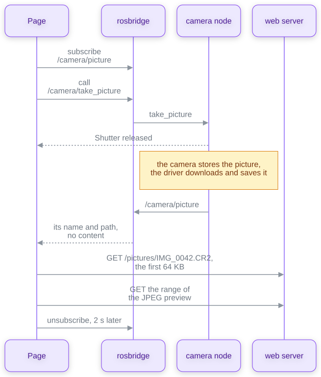

# The Test Page

## Table of Contents <!-- omit in toc -->

- [Introduction](#introduction)
- [The Big Picture](#the-big-picture)
- [The Layers](#the-layers)
- [Talking to the Driver](#talking-to-the-driver)
  - [The rosbridge Client](#the-rosbridge-client)
  - [One rosbridge per Module](#one-rosbridge-per-module)
- [The Camera Section](#the-camera-section)
  - [The Live View](#the-live-view)
  - [The Settings](#the-settings)
  - [The Test Shot](#the-test-shot)
- [Tests](#tests)
- [How to Extend the Page](#how-to-extend-the-page)
- [Design Decisions and Trade-offs](#design-decisions-and-trade-offs)

## Introduction

This document explains how the test page of StepIt Camera, in [`web`](../web), is built, and where to start when we want to change something. It assumes we have read [The Test Page](../README.md#the-test-page) in the README and used the page once.

The page tries the camera and the driver from a browser, and nothing beyond them. It follows one idea: **the page has no server of its own, the browser talks to the driver's servers directly**. The code that talks to the driver, `ros/` and `camera/`, does not depend on the page, and can be reused by another web application.

## The Big Picture

The page is a single-page React application, built into `web/dist` and served as static files by the driver's web server. It has no API of its own: the browser talks to the driver's servers directly.

<!-- The source is diagrams/web-page.mmd: change it, then run bin/render-diagrams.sh. -->

What the page uses of the driver, see [ARCHITECTURE.md](ARCHITECTURE.md#the-big-picture) for the whole interface:

| Server | Port | What the page uses |
|---|---|---|
| The web server | `8090` | `/`, the page itself, and `/pictures/<file name>`, a saved picture, with `Range` requests. |
| rosbridge | `9091` | The services `get_settings`, `set_parameters`, `start_streaming`, `stop_streaming` and `take_picture` of the camera node, and its topic `picture`. |
| web_video_server | `8081` | `/stream?topic=/camera/preview&type=ros_compressed`, the live view. |

The page does not use the topic `status`, the field `relative_path` of a picture, the parameter `folder` or the listings of the web server. The page and the pictures come from the page's own origin; the other two servers are on ports 9091 and 8081 of the host that served the page, unless the preferences name others. The development server, `dev`, serves the page on port 5174 and passes `/pictures` on to port 8090.

## The Layers

The client is in `src/client`, in three layers, each importing only from those below it:

| Layer | Files | Knows about |
|---|---|---|
| Transport | `ros/rosbridge.ts`, `ros/connection.ts` | rosbridge's protocol, and the status of each connection. Nothing about the camera. |
| Camera | `camera/camera.ts`, `camera/format.ts`, `camera/picture.ts`, `camera/raw.ts` | The camera's ROS interface, and its pictures on the web server. No React. |
| State and views | `camera/store.ts`, `components/`, `App.tsx` | What the user sees and does. |

`settings.ts` keeps the preferences of the browser in `localStorage`: the theme, where the camera's rosbridge and web_video_server are, and the name of the camera node. The state lives in [zustand](https://github.com/pmndrs/zustand) stores. The imports, as they are:

<!-- The source is diagrams/web-layers.mmd: change it, then run bin/render-diagrams.sh. -->

No import goes upwards. Three details are easy to miss:

- **`camera/store.ts` belongs to the top layer** although it is in the folder `camera/`: it is the only file of that folder that imports zustand and `settings.ts`. The other files of `camera/` know neither React nor the preferences: `Camera` gets its `Rosbridge` and the name of the node from its caller.
- **`ros/connection.ts` keeps the status of the connections in a zustand store**, which gives the components a hook, `useStatus()`; `ros/rosbridge.ts` imports nothing.
- **`settings.ts` reads `window.matchMedia` when it is imported**, to apply the theme. Whatever imports it, i.e. `store.ts` and the components, cannot be loaded by the tests, which run in Node.js without a browser.

## Talking to the Driver

### The rosbridge Client

`Rosbridge` in [`rosbridge.ts`](../web/src/client/ros/rosbridge.ts) is a small client of the rosbridge protocol, written for the page rather than taken from `roslibjs`:

- `callService()` sends `call_service` and resolves with the `service_response`. It fails at once when not connected, rather than waiting, so that a button can say it did not work; and it fails after a timeout, 10 seconds unless the caller gives another, or when the connection drops.
- `subscribe()` sends one `subscribe` per topic, whatever the number of listeners, and `unsubscribe` with the last one. The type and the QoS are those of the first listener. The subscriptions survive a reconnection.
- The connection comes back on its own, every 2 seconds, e.g. while the driver restarts.
- A message larger than rosbridge's fragment size, 10 MB, comes as `fragment` messages, which the client puts back together. No message of the camera is that large, since the pictures come over HTTP; the client handles them all the same.
- A `uint8[]` field comes as base64 text: `decodeBytes()` turns it back into bytes. The page has no such field to read; only the tests call it.

### One rosbridge per Module

A rosbridge can only handle the messages installed in its own environment, so the camera brings one that is sure to know `stepit_camera_msgs`, on port 9091 rather than the default 9090, where another rosbridge may run. [`connection.ts`](../web/src/client/ros/connection.ts) keeps one connection per URL, shared by whoever uses it, with its status, which the top of the page shows: the page has a single section, the camera, but a page talking to several ROS2 systems, each with its own rosbridge, would open one connection per system.

## The Camera Section

`Camera` in [`camera.ts`](../web/src/client/camera/camera.ts) is the camera driver's interface: one method per service, `onPicture()` for the topic, and the addresses of a picture and of the live view. [`store.ts`](../web/src/client/camera/store.ts) holds the section's state, and `followCamera()` keeps it up to date while the section is open.

### The Live View

The live view is a plain `` whose source is web_video_server's MJPEG stream, with `type=ros_compressed`: the camera's JPEG frames go to the browser as they are, never decoded. The topic is written unescaped in the URL, since web_video_server does not decode `%2F`.

The driver only sends frames while streaming is on. During a test shot, no frame comes: the mirror goes down for the shot, and the driver is busy downloading the picture. The `` keeps the last frame, which the page greys out from the click until the picture has come. The page only knows about its own test shots: it greys nothing out for a shot fired by an external device.

The page keeps its own idea of whether the live view is on, `streaming` in the store, which starts off: it does not read `streaming` from the driver's `status` topic. The Start and Stop buttons set it and call `start_streaming` and `stop_streaming`, so opening the page never raises the mirror; a live view that the driver already runs, started with `stream:=true` or by another client, shows as off until Start is clicked. Once started, the page calls `start_streaming` again whenever rosbridge reconnects, e.g. after the driver restarted, since a new driver starts with the live view off.

When the stream cannot be loaded, the `` is replaced by a message that names web_video_server, with a Retry button that opens the stream again.

### The Settings

`get_settings` returns each setting with its value and the values the camera accepts right now. The page reads them when it connects, after each change, and every 3 seconds, to follow the mode dial and changes made on the camera itself; it skips a reading while a change or a test shot is under way, when the driver is busy. A setting with fewer than two choices is disabled. A change is a `set_parameters` call, as `ros2 param set` does, with the value as a string; when the camera refuses it, the reason, which lists the accepted values, is shown under the setting.

[`format.ts`](../web/src/client/camera/format.ts) orders and labels the settings, and writes their values as the camera does, e.g. `f/5.6` and `1/125 s`. A setting it does not know is still shown, by its name: a setting added to the driver needs no change here.

### The Test Shot

<!-- The source is diagrams/test-shot.mmd: change it, then run bin/render-diagrams.sh. -->

The page subscribes to `/camera/picture` only while it waits for its shot, since it only shows its own shots. It subscribes before releasing the shutter, so that the picture cannot come first, and keeps listening 2 seconds after the first file, for the second file of a RAW+JPEG shot. Every picture that comes meanwhile is shown, whoever fired it. `take_picture` may take 15 seconds to answer, and the first picture 60 seconds to come; after that, the page says that the picture did not reach it. A picture that finishes loading after the next shot started is dropped.

The message carries the path of the file, not its content: [`picture.ts`](../web/src/client/camera/picture.ts) loads it from the web server, at `/pictures/<file name>`, the path's last part, since the driver may have added a suffix to the camera's name. The page does not use `relative_path`: it finds a picture only while the driver's parameter `folder` is empty, the default. The page is served by the same server, so the address is relative; the development server passes `/pictures` on to port 8090.

A JPEG is shown from the server as it is. A browser cannot show a RAW file, but a Canon CR2 carries a full-size JPEG preview: [`raw.ts`](../web/src/client/camera/raw.ts) finds it in the TIFF structure of the file, as the first image's only strip, whose location is in the first 64 KB. `picture.ts` reads those with a `Range` request, of any file, a JPEG included, then the preview with another, about 1.4 MB of a 30 MB file, and shows it through an object URL. The size of the whole file comes from `Content-Range`. The name of the file links to it, to download it whole.

## Tests

The tests, in [`tests`](../web/tests), run with vitest in Node.js, without a browser or a camera. `test` runs them with the driver's, `pnpm run test` in `web` runs them alone, and the workflow `web.yml` runs them in CI, with the type check and the build. [`fakeSocket.ts`](../web/tests/fakeSocket.ts) stands in for the WebSocket, records what the page sends, and answers as rosbridge would.

| Test | Cases | What it covers |
|---|---|---|
| `rosbridge.test.ts` | 8 | The protocol: calls, errors, timeouts, subscriptions, fragments and reconnections. |
| `camera.test.ts` | 9 | The camera's requests and responses, the address of a picture and of the live view, and the formatting of the settings. |
| `raw.test.ts` | 3 | The preview of a RAW file, on a TIFF built by [`tiff.ts`](../web/tests/tiff.ts). With `RAW_SAMPLE=<file.CR2>`, a fourth case checks a real file. |
| `picture.test.ts` | 6 | Loading a picture, against a fake `fetch`: the ranges asked for, a server without ranges, and a missing file. |

What has no test: the components, which are thin, and `camera/store.ts`, which is not: the sequence of a test shot, the periodic reading of the settings and the live view started again after a reconnection are checked in a browser, against the fake camera (`fake:=true`). So are `ros/connection.ts` and `settings.ts`.

## How to Extend the Page

**A new service or topic of the driver** is a method of `Camera` in [`camera.ts`](../web/src/client/camera/camera.ts), and a case in `camera.test.ts` against `fakeSocket.ts`; the store calls it, and a component shows the result.

**A new setting of the camera** needs nothing: the page shows whatever `get_settings` returns. Its label, its place in the list and the way its values read are in `LABELS` and `formatValue()` of [`format.ts`](../web/src/client/camera/format.ts).

**A new preference of the browser** is a field of `Settings` and of `DEFAULTS` in [`settings.ts`](../web/src/client/settings.ts), and a control in `components/SettingsMenu.tsx`.

**Another section of the page** is an entry of `SECTIONS` in [`App.tsx`](../web/src/client/App.tsx), with the rosbridge whose connection the top of the page shows.

**Another RAW format** is its preview in [`raw.ts`](../web/src/client/camera/raw.ts): `previewLocation()` reads the first image of a TIFF, which is where a Canon CR2 keeps it.

## Design Decisions and Trade-offs

**No API.** The browser reaches the driver's servers directly: the web server for the page and the pictures, rosbridge for the rest, and web_video_server for the live view. The price is that the browser must reach three ports, 8090, 8081 and 9091.

**web_video_server for the live view.** The live view is 10 frames per second: through rosbridge, each would be a base64 JSON message, decoded by JavaScript. web_video_server streams the JPEG frames as they are, and the browser shows MJPEG natively.

**The pictures come over HTTP, not through rosbridge.** Through rosbridge, a 30 MB RAW file would be 40 MB of base64 text in JSON, in fragments, ahead of every service call on the same WebSocket, and decoded by JavaScript on the page's thread. Over HTTP, the browser loads it in binary, in the background, and only the part the page shows: see [The Test Shot](#the-test-shot).

**Our own rosbridge client.** The page needs little of rosbridge: a few calls and subscriptions. `roslibjs` would bring more than we use, and callbacks rather than promises.
